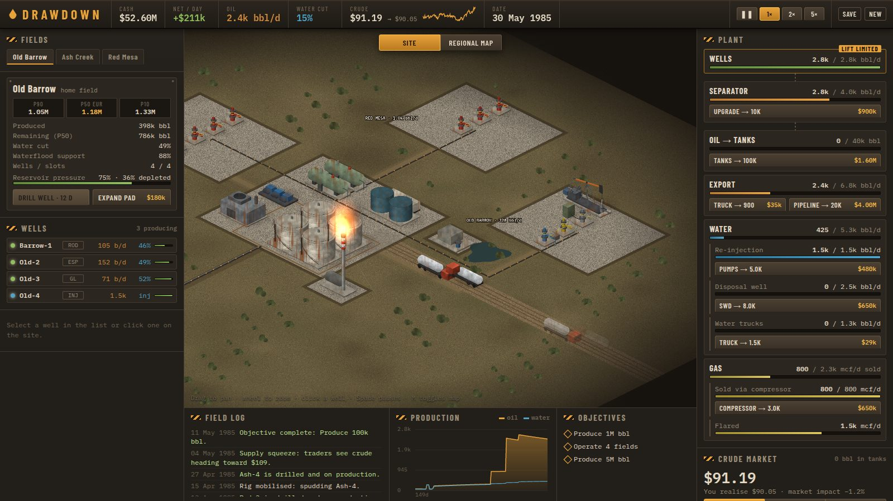
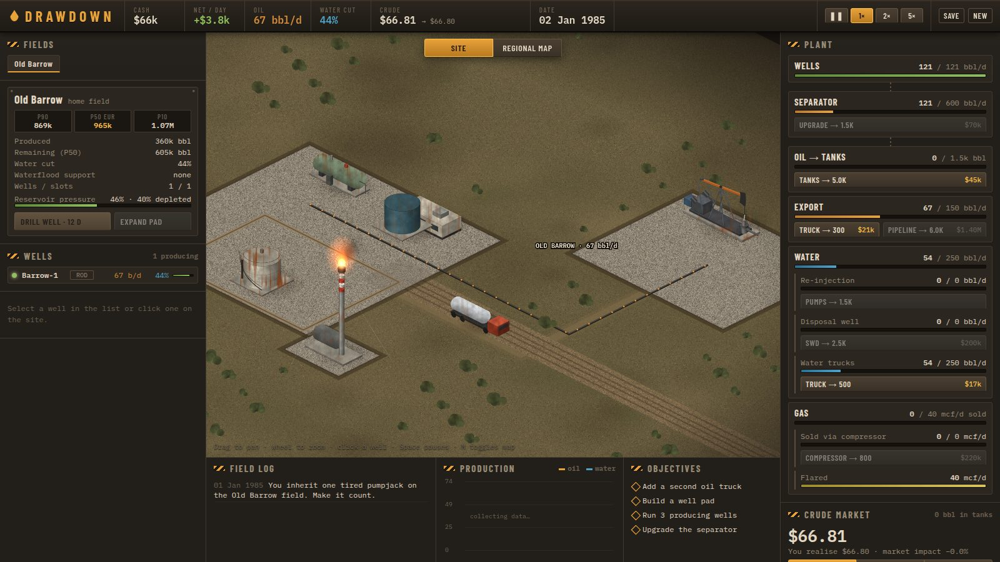
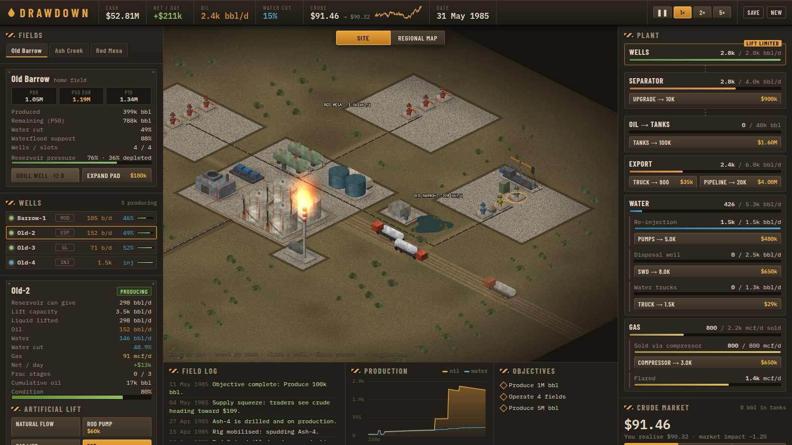
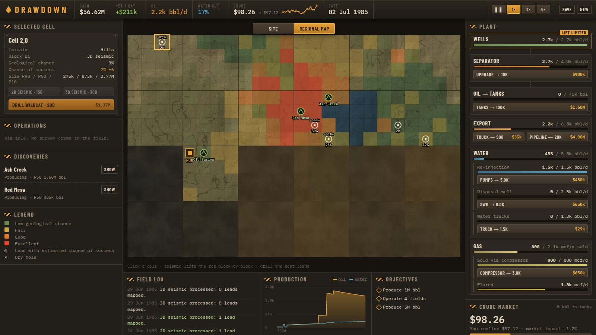
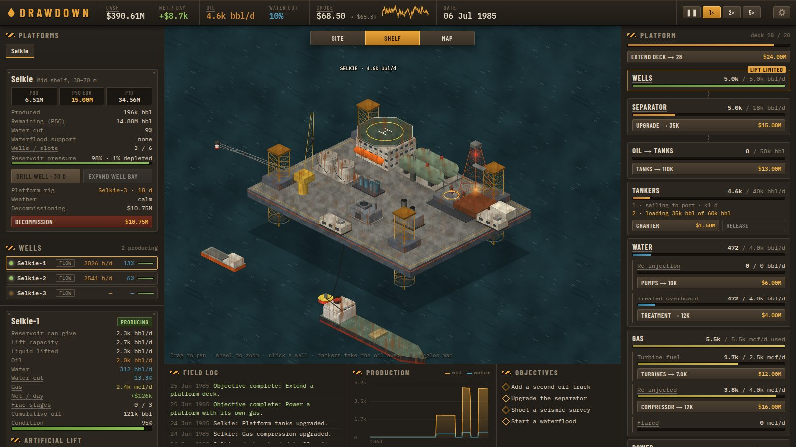
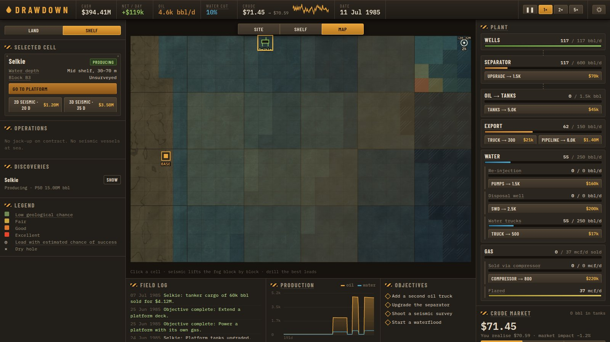

# Drawdown — MVP

Состояние на 8 октября 2026. Первая играбельная версия игры из [IDEA.md](../IDEA.md): ядро симуляции, первый слой прогрессии (наземная качалка → куст скважин → несколько месторождений) и разведка.



## Документы

| Файл | О чём |
|---|---|
| [gameplay.md](gameplay.md) | Игровые механики и формулы: пласт, обводнённость, каскад, рынок, износ, разведка, прогрессия |
| [architecture.md](architecture.md) | Устройство кода: симуляция, рендер, UI, сохранения, инструменты разработки |
| [balance.md](balance.md) | Числа, темп игры по прогонам бота, история настройки, где крутить |
| [shelf.md](shelf.md) | Второй слой: шельф, платформы, танкеры, палуба, штормы, ликвидация |
| [roadmap.md](roadmap.md) | Известные проблемы, что отложено, следующие шаги |

## Запуск

```sh
npm install
npm run dev      # http://localhost:5173
npm test         # тесты симуляции (vitest)
npm run build    # проверка типов + бандл в dist/
```

## Решения, принятые на старте

Перед началом работы были заданы вопросы, ответы такие:

| Вопрос | Решение |
|---|---|
| Стек | TypeScript + Vite + PixiJS. Сцена на Pixi (WebGL), интерфейс по краям на обычном HTML/CSS. Rust/WASM не нужен: шаг симуляции занимает около 0.1 мс |
| Объём первой итерации | Ядро + первый слой + разведка. Хеджирование и морские слои отложены |
| Графика | Процедурная: всё рисуется кодом и запекается в текстуры. Отдельный слой позволяет заменить любой спрайт на нарисованный |
| Язык интерфейса | Английский; позже добавлен русский как опция (меню-шестерёнка) |

## Что вошло, относительно IDEA.md

| Идея | Статус |
|---|---|
| Добыча падает по кривой (decline curve), а не обрывается | ✅ Гиперболическая кривая Арпса, считается от выработки |
| Борьба с падением: закачка воды, газлифт, ЭЦН, ГРП | ✅ Всё есть, плюс штанговый насос и фонтан |
| Обводнённость, сепарация и утилизация воды, решение «держать или глушить» | ✅ Рост обводнённости по сигмоиде; у каждой скважины видна дневная прибыль; можно остановить, ликвидировать или перевести под закачку |
| Каскад: сырьё → сепарация → хранение → вывоз, узкое место смещается | ✅ Сепаратор, резервуары, вывоз, отдельно вода и газ. Узкое место подсвечивается |
| Прокачка на уровне площадки и рост от наземного куста | ✅ Уровни объектов, кусты на 1→4→6→8 скважин, до 5 месторождений |
| Динамическая цена, падает при продаже запаса | ✅ Цена возвращается к среднему, меняются режимы рынка, продажи давят цену |
| Хеджирование и фьючерсы | ⏳ Отложено |
| Слои: самоподъёмная платформа (jack-up), глубоководная платформа, FPSO, полупогружная, Арктика | ✅ Самоподъёмные платформы на шельфе (второй слой, см. [shelf.md](shelf.md)). ⏳ Глубоководье, FPSO, полупогружная, Арктика |
| Сейсморазведка как «туман войны», разведочная скважина как ставка | ✅ Блоки 4×4, 2D/3D, пустая скважина или открытие с баннером |
| P90/P50/P10, оценка уточняется по ходу добычи | ✅ Для месторождений и для лидов после 3D |
| Изометрический индастриал, платформа в центре, интерфейс по краям | ✅ Ржавчина и грязь процедурным шумом |
| Браузер | ✅ Только статические файлы, без сервера |

## Скриншоты

| | |
|---|---|
|  Старт: одна качалка, хаб, факел |  Карточка скважины с ЭЦН: потенциал пласта, производительность насоса, прибыль в день |
|  Карта разведки: 2D/3D-блоки, тепловая карта шансов, лиды |  Три месторождения, закачка, компрессор, трубопровод |
|  Самоподъёмная платформа: танкер под наливом, буровая, каскад платформы |  Карта шельфа: берег и база, глубины, заштрихованный склон |

## Проверка

- 13 тестов симуляции (`tests/sim.test.ts`): падение добычи, рост обводнённости, ограничения каскада, эффект заводнения, dry-run без побочных эффектов, разведка, детерминизм по seed, сохранение туда-обратно, миграция сохранения v1 → v2, предел офлайна.
- 7 тестов локализации (`tests/i18n.test.ts`): одинаковые плейсхолдеры в en/ru, русские формы plural, перевод журнала и причин отказа, единицы и даты.
- `npm run build` проходит, типы чистые.
- Сцена проверена в headless Chromium: старт, мид-гейм, карта, клик по скважине, сохранение с перезагрузкой. Ошибок в консоли нет.
- Русский интерфейс проверен там же на 1440 и 1280 px: интро, площадка, карта, карточки-подсказки (в том числе на заблокированных кнопках), меню-шестерёнка и переключение языка без перезагрузки.
- На реальной видеокарте FPS не мерился: в headless WebGL программный (swiftshader), поэтому там около 4 FPS. Профиль показал, что JS почти простаивает.
