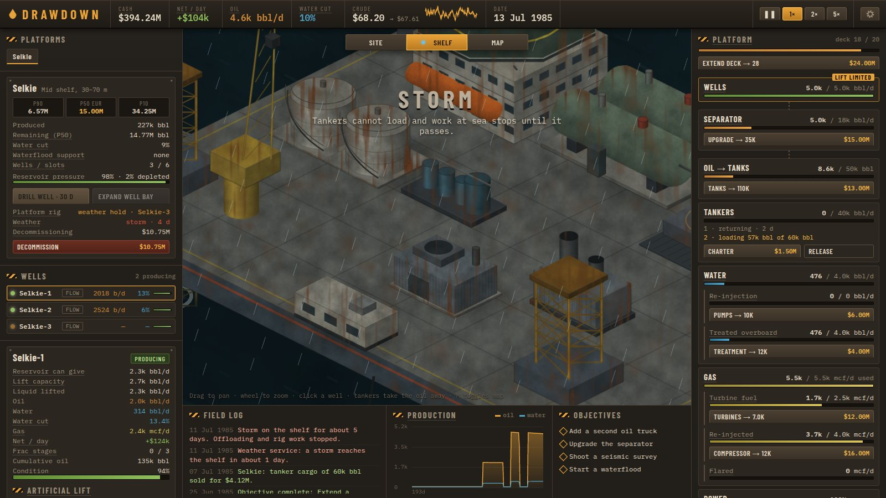

# Второй слой: шельф

Состояние на 9 октября 2026. Самоподъёмные платформы (jack-up) на мелководье: отдельная карта разведки, до трёх платформ, вывоз танкерами, палуба как ресурс, газ на турбины, штормы, ликвидация. Числа взяты из `OFFSHORE`, `DECK`, `MODULES` и `SHELF` в `src/game/balance.ts`.


## Решения владельца проекта

| Вопрос | Решение |
|---|---|
| Где искать нефть на шельфе | Отдельная карта шельфа, переключатель «Суша / Шельф» на вкладке карты. Генерируется при покупке лицензии, старые сохранения не ломаются |
| Сколько платформ | Несколько, до трёх. У каждой своя палуба, свой каскад и свои танкеры. Ликвидация освобождает место под новую |
| Что вошло в первую итерацию | Палуба как место под модули, газ как топливо турбин, штормы, ликвидация |
| Чем отличается от суши | Вывоз только танкерами, одна буровая на платформу, всё в разы дороже, важные сигналы видны сразу |

## Чем шельф отличается от суши

| | Суша | Шельф |
|---|---|---|
| Вывоз | Нефтевозы и трубопровод, непрерывно | Танкеры-челноки, партиями по 60 тыс. барр. |
| Бурение | Кусты бурятся параллельно, $350k, 12 сут | Одна буровая на платформу, по очереди: $4M × глубина структуры, 30 сут |
| Ремонт, смена лифта, перевод под закачку | Сразу | Ждут свободную буровую. ГРП делает судно, буровая не нужна |
| Лифты | Все четыре | Без качалки. Производительность ×4, цена ×4. Газлифт требует модуль компрессии газа |
| Вода | Закачка, поглощающая скважина, водовозы | Закачка, затем очистка и сброс за борт |
| Газ | Компрессор продаёт, остаток в факел ($0.30/mcf) | Турбины, закачка в пласт, остаток в факел ($4/mcf) |
| Электричество | $/барр. подъёма из сети | Дизель или попутный газ в турбинах |
| Постоянные расходы | $200/сут хаб + объекты | $35k/сут вахта и вертолёты + модули + фрахт танкеров |
| Погода | Нет | Штормы |

## Лицензия и карта шельфа

- **Лицензия на шельф**: $15M, нужны «Exploration license» и «Waterflood». При покупке генерируется карта шельфа 24×16.
- **Карта**: на западе берег с базой снабжения, дальше на восток глубина растёт. Туман на шельфе полупрозрачный: глубины известны по морским картам, скрыта только геология.

  | Код | Зона | Множитель стоимости платформы и поисковой скважины |
  |---|---|---|
  | 4 | Берег | бурить нельзя |
  | 5 | Мелководье, до 30 м | ×1 |
  | 6 | Средний шельф, 30–70 м | ×1.25 |
  | 7 | Внешний шельф, 70–110 м | ×1.6 |
  | 8 | Склон, глубже 120 м | самоподъёмная не встанет (заштриховано; задел для глубоководного слоя) |

- **Нефтеносные зоны**: три, сила 0.3–0.6, множитель размера ×1 / ×1.5 / ×2.3 (самая богатая дальше всех от берега). Лидов меньше, чем на суше: `0.02 + 0.22 · prior`.
- **Лиды на шельфе**: OOIP lognormal(22 млн · размер, σ 0.8), RF 0.2–0.3, продуктивность lognormal(2000 барр./сут, σ 0.35), газовый фактор 300–2200, множитель стоимости скважин `1 + размер · U(0.1, 0.3)`.
- **Сейсмика**: 2D $1.2M, 20 сут; 3D $3.5M, 35 сут. Точность та же, что на суше.
- **Поисковая скважина**: $9M × глубина × множитель лида, 40 сут. Самоподъёмная буровая для разведки одна, независимо от наземной. ФОНТАН, если P50 > 15 млн барр.

## Платформа

- **Установка**: `(20M + 0.35M · расстояние до базы) · глубина`, 60 сут. Корпус буксируют и поднимают на опорах: на сцене палуба ползёт вверх по ногам. Когда готово, первооткрывательница запускается в добычу и приходит первый танкер.
- **Лимит**: 3 платформы, включая строящиеся и ликвидируемые.
- **Стартовая комплектация**: палуба 14, устьевая зона на 3 скважины, сепаратор 8 тыс. барр./сут, ёмкости 20 тыс. барр., водоочистка 4 тыс. барр./сут, один танкер.

### Палуба и модули

Место на палубе общее. Каждый уровень модуля занимает свою площадь, расширение требует свободного места. Решение: больше скважин или больше переработки.

| Палуба | Площадь | Цена |
|---|---|---|
| 0 | 14 | — |
| 1 | 20 | $9M |
| 2 | 28 | $24M |

| Модуль | Уровни (мощность / площадь) | Цены уровней |
|---|---|---|
| Устьевая зона, мест | 3/3 → 6/6 → 9/9 → 12/12 | — / $5M / $9M / $14M |
| Сепаратор, барр./сут жидкости | 8k/2 → 18k/3 → 35k/5 | — / $6M / $15M |
| Ёмкости, барр. | 20k/2 → 50k/4 → 110k/6 | — / $5M / $13M |
| Водоочистка, барр./сут | 4k/1 → 12k/2 → 30k/3 | — / $4M / $10M |
| Насосы закачки, барр./сут | 0 → 10k/2 → 25k/3 | $6M / $14M (нужна технология Waterflood) |
| Турбины, mcf/сут топлива | 0 → 2.5k/2 → 7k/3 | $5M / $12M |
| Компрессия газа, mcf/сут | 0 → 4k/2 → 12k/3 | $7M / $16M |

Старт занимает 8 из 14. Всё на максимуме требует 35, а палуба вмещает 28, так что всё сразу не поставить.

### Каскад платформы

```
Скважины → Сепаратор ─┬─ Нефть → Ёмкости → Танкер у буя → рейс → продажа в порту
                      ├─ Вода  → Закачка (+ морская вода) → Очистка → за борт
                      └─ Газ   → Турбины (топливо) → Закачка газа → Факел
```

- Скважины душатся тем же общим кодом, что на суше (`src/game/plant.ts`), включая SCADA.
- **Нефть**: место для нефти = `ёмкости − запас + налив в танкер за шаг`. Налив идёт до 40 тыс. барр./сут, только пока танкер стоит у буя и нет шторма. Если ёмкости полны, а танкера нет, узкое место — ёмкости. В карточке это объяснено: «танкер не успевает».
- **Энергия**: потребность в $/сут дизеля = 12k + подъём жидкости × тариф лифта × 1.5 + закачка × $0.10/барр. Турбины сжигают газ, каждый mcf экономит $7 дизеля. Остаток газа идёт в пласт через компрессию ($0.25/mcf), остальное сжигается на факеле ($4/mcf).
- **Вода**: сначала обратная закачка ($0.30/барр.; нехватку добирают морской водой за +$0.05), затем очистка и сброс за борт ($0.60/барр.).
- **Постоянные расходы**: вахта и вертолёты $35k/сут, опер. расходы модулей, фрахт $14k/сут за танкер. Скважины на море обслуживаются в 4 раза дороже.

### Танкеры

Цикл: на якоре → у буя под наливом → рейс в порт → продажа → обратный рейс.

- Груз 60 тыс. барр. Танкер уходит, когда полон или простоял у буя 12 сут.
- Рейс в одну сторону: `4 + 0.35 · расстояние до базы` сут.
- В порту груз продаётся целиком по реализуемой цене. Давление на цену считается по глубине морского рынка (3 млн барр.).
- Режимы рынка действуют и на море: в «Пороге» и «Копить» гружёный танкер ждёт цену в порту, а фрахт капает.
- Фрахт ещё одного танкера: $1.5M за мобилизацию, затем $14k/сут, до 4 штук. Пустой танкер вдали от буя можно вернуть, последний остаётся.
- Выручка от грузов приходит рывками. Для баланса и «прибыли в сутки» она сглаживается средним за 30 сут (`revenueEma`), а деньги начисляются сразу при продаже.

### Буровая платформы

Одна на платформу. Бурение, смена лифта (кроме перевода на фонтан), ремонт и перевод под закачку и обратно идут по очереди. Пока буровая занята, кнопки показывают «Буровая занята: <скважина>». Бригада обслуживания (технология) не запускает ремонт, пока буровая занята. На сцене буровая переезжает к скважине, над которой работает.

| Работа на море | Стоимость |
|---|---|
| Бурение | $4M × множитель месторождения, 30 сут |
| Лифт | ×4 от наземной цены |
| ГРП | ×6 |
| Обслуживание | ×4 |
| Ремонт | ×5 |
| Перевод под закачку и обратно | $900k |
| Ликвидация скважины | $1.5M |

### Штормы

- Первый шторм — через ~140 сут после лицензии, дальше раз в 50–140 сут, длительность 3–8 сут. За 5 сут в журнале появляется предупреждение.
- Во время шторма танкеры не наливаются, стоит вся работа на море: бурение, ремонт, стройка, ликвидация, сейсмика и разведочное бурение на шельфе.
- Видно сразу: баннер «ШТОРМ», затемнение и дождь на сцене, синяя точка на вкладке «Шельф», строка «Погода» в карточке платформы.

### Ликвидация

- Стоимость `(5M + 1.2M · скважин) · глубина` видна заранее в карточке платформы. Длится 40 сут, подтверждается модалкой.
- Все скважины глушатся сразу. Нефть из ёмкостей уходит с танкером, если он у буя; гружёные танкеры довозят груз и продаются. Месторождение помечается ликвидированным, место по лицензии освобождается после демонтажа.

## Экономика (прогоны)

Скрипт держит буровую занятой до 6 скважин (3 на мелких залежах), фрахтует 2 танкера, с бригадой обслуживания, без апгрейда сепаратора. Ликвидирует, когда добыча упала ниже 8% пика и платформа в минусе. 1800 сут после установки, 44 удачных лида на 8 seed:

| Извлекаемые запасы | Итог за 1800 сут |
|---|---|
| < 5 млн барр. | −$36M … −$80M |
| 5–7 млн | около нуля (−$29M … +$18M) |
| 8–15 млн | +$40M … +$145M |
| > 15 млн | +$200M … +$470M |

Вход на шельф стоит около $100M: лицензия, сейсмика, 2–3 поисковые скважины, платформа, первые скважины. К этому моменту первый слой обычно накапливает $30–110M (см. [balance.md](balance.md)). Окупаемость хорошей платформы — 300–450 сут. Поэтому решение «ставить платформу или нет» зависит от P50 после 3D: мелкая залежь на шельфе убыточна, хотя на суше считалась бы богатой.

## Что видно на сцене



- Море: тайлящаяся вода с зыбью и бликами. В шторм она темнеет и движется быстрее, поверх идут затемнение и дождь.
- Платформа: четыре решётчатые опоры, корпус (растёт с уровнем палубы), жилой блок со спасательными шлюпками и вертолётной площадкой, кран, факельная стрела влево над морем (пламя по объёму факела), устьевая зона с решёткой, буровая вышка с огнём на кронблоке.
- Модули видны по уровню: сепараторы, ёмкости, водоочистка, насосы закачки, турбины с выхлопными трубами, компрессор. На расширенной палубе стоят контейнеры.
- Танкеры: у буя под наливом со шлангом, на якоре в очереди, уходят и приходят из-за края сцены. Есть судно снабжения.
- Маяки: узкое место (сепаратор, ёмкости, вода), занятые и отказавшие скважины.


